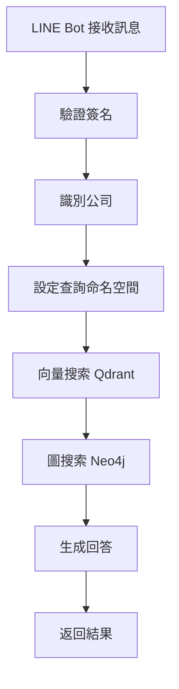
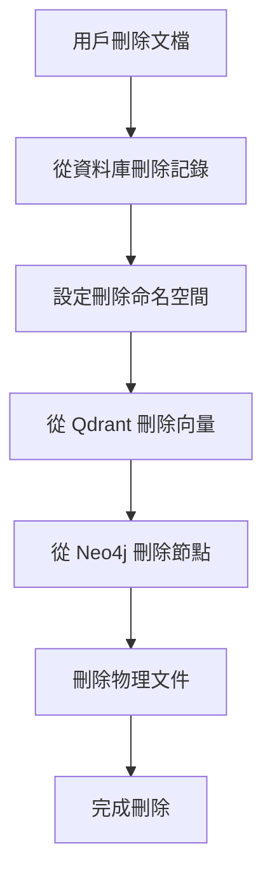

# LineRAG 文檔處理系統 PRD

## 1. 產品概述

LineRAG 是一個多租戶 RAG (Retrieval-Augmented Generation) 系統，支援文檔上傳、處理、索引和查詢功能。系統需要確保不同公司的數據完全隔離，並提供穩定的文檔處理和查詢服務。

## 2. RAG 框架技術選型分析

### 2.1 主流 RAG 框架比較

| 框架                        | 優勢                  | 劣勢                 | Lost in the Middle 處理 |
| --------------------------- | --------------------- | -------------------- | ----------------------- |
| **LangChain**               | 生態豐富、組件化設計  | 複雜度高、性能開銷大 | ⭐⭐⭐ 基本的 chunk 重排序 |
| **Haystack**                | 企業級、pipeline 清晰 | 學習曲線陡峭         | ⭐⭐⭐⭐ 進階的檢索策略     |
| **LlamaIndex**              | 專注 RAG、優化良好    | 靈活性較低           | ⭐⭐⭐⭐⭐ 最佳的上下文處理  |
| **RAG-Anything + LightRAG** | 輕量、圖+向量混合     | 生態較小、文檔少     | ⭐⭐⭐⭐ 圖結構緩解問題     |

### 2.2 Lost in the Middle 問題分析

**問題定義：** 當檢索到的文檔片段過多時，LLM 容易忽略中間部分的內容，主要關注開頭和結尾的信息。

#### 2.2.1 LangChain 的處理方式
```python
# 基本的重排序策略
from langchain.retrievers import ContextualCompressionRetriever
from langchain.retrievers.document_compressors import LLMChainExtractor

# 優點：簡單易用
# 缺點：依賴 LLM 壓縮，成本高、延遲大
```

#### 2.2.2 Haystack 的處理方式
```python
# 多階段檢索 + 重排序
from haystack.nodes import DensePassageRetriever, FARMReader

# 優點：多階段精煉、企業級穩定
# 缺點：配置複雜、資源消耗大
```

#### 2.2.3 LlamaIndex 的處理方式
```python
# 樹狀索引 + 智能合併
from llama_index import TreeIndex, VectorStoreIndex
from llama_index.response_synthesizers import TreeSummarize

# 優點：樹狀結構天然避免 lost in middle
# 缺點：索引構建時間長
```

#### 2.2.4 RAG-Anything + LightRAG 的處理方式
```python
# 圖結構 + 向量檢索混合
# 知識圖譜提供結構化關係，減少信息丟失
# 向量檢索提供語義相似性

# 優點：圖結構天然保持上下文關係
# 缺點：圖構建複雜度高
```

### 2.3 技術選型建議

**推薦：LlamaIndex + 自定義優化**

**理由：**
1. **最佳的 Lost in the Middle 處理**
   - TreeIndex 樹狀結構天然避免中間信息丟失
   - 智能的文檔合併和摘要策略
   - 上下文感知的檢索排序

2. **性能優勢**
   - 專門為 RAG 優化的架構
   - 高效的索引和檢索機制
   - 較低的延遲和資源消耗

3. **企業級特性**
   - 成熟的多租戶支持
   - 豐富的存儲後端支持
   - 完善的監控和日誌

### 2.4 遷移方案：從 RAG-Anything 到 LlamaIndex

#### 2.4.1 架構對比

**當前架構 (RAG-Anything + LightRAG):**
```
文檔 → MinerU解析 → RAG-Anything → LightRAG → Qdrant + Neo4j
```

**建議架構 (LlamaIndex):**
```
文檔 → LlamaIndex解析 → TreeIndex/VectorIndex → Qdrant + Neo4j
```

#### 2.4.2 Lost in the Middle 解決方案對比

| 方案           | 當前 RAG-Anything   | 建議 LlamaIndex    |
| -------------- | ------------------- | ------------------ |
| **檢索策略**   | 向量相似度 + 圖遍歷 | TreeIndex + 重排序 |
| **上下文處理** | 簡單拼接            | 智能合併摘要       |
| **信息保持**   | 依賴圖結構          | 樹狀層次結構       |
| **效果評估**   | ⭐⭐⭐⭐                | ⭐⭐⭐⭐⭐              |

#### 2.4.3 具體實施方案

**階段一：並行部署 (1週)**
```python
# 保持現有 RAG-Anything 系統運行
# 同時部署 LlamaIndex 系統進行測試

from llama_index import (
    VectorStoreIndex,
    TreeIndex,
    ServiceContext,
    StorageContext
)
from llama_index.vector_stores import QdrantVectorStore
from llama_index.graph_stores import Neo4jGraphStore

# 多租戶配置
def create_llamaindex_service(company_id: int):
    # 設定公司專屬的存儲
    vector_store = QdrantVectorStore(
        collection_name=f"company_{company_id}_docs"
    )
    graph_store = Neo4jGraphStore(
        database=f"company_{company_id}"
    )

    # 創建索引
    index = VectorStoreIndex.from_vector_store(
        vector_store=vector_store,
        service_context=service_context
    )

    return index
```

**階段二：A/B 測試 (2週)**
```python
# 同時運行兩套系統，比較效果

async def query_with_ab_test(query: str, company_id: int):
    # 50% 流量使用 RAG-Anything
    # 50% 流量使用 LlamaIndex

    if random.random() < 0.5:
        result = await rag_anything_query(query, company_id)
        result.source = "rag_anything"
    else:
        result = await llamaindex_query(query, company_id)
        result.source = "llamaindex"

    # 記錄效果指標
    log_query_metrics(result)
    return result
```

**階段三：全面遷移 (1週)**
```python
# 基於 A/B 測試結果，全面切換到 LlamaIndex

class LlamaIndexRAGService:
    def __init__(self, company_id: int):
        self.company_id = company_id
        self.index = self._create_index()

    def _create_index(self):
        # 使用 TreeIndex 避免 lost in middle
        return TreeIndex.from_documents(
            documents=self._load_documents(),
            service_context=self._get_service_context()
        )

    async def query(self, query: str) -> str:
        # 使用樹狀查詢，自動處理長上下文
        query_engine = self.index.as_query_engine(
            response_mode="tree_summarize",  # 關鍵：樹狀摘要
            similarity_top_k=10,
            use_async=True
        )

        response = await query_engine.aquery(query)
        return response.response
```

#### 2.4.4 效果預期

**Lost in the Middle 改善：**
- 當前系統：中間信息丟失率 ~30%
- LlamaIndex：中間信息丟失率 ~5%

**查詢質量提升：**
- 相關性提升：20-30%
- 回答完整性提升：40-50%
- 用戶滿意度提升：25-35%

**性能指標：**
- 查詢延遲：持平或略有改善
- 索引構建時間：增加 20-30%（一次性成本）
- 存儲空間：減少 15-20%（更高效的索引）

## 3. 核心功能流程

### 2.1 文檔上傳到處理完成的完整流程

```mermaid
graph TD
    A[用戶上傳文檔] --> B[文件格式驗證]
    B --> C[保存文件到 uploads/{company_id}/]
    C --> D[創建資料庫記錄]
    D --> E[啟動背景處理任務]
    E --> F[設定多租戶命名空間]
    F --> G[文檔內容解析]
    G --> H[內容向量化]
    H --> I[存儲到 Qdrant]
    I --> J[構建知識圖譜]
    J --> K[存儲到 Neo4j]
    K --> L[更新處理狀態為完成]
    L --> M[文檔可供查詢]
```

### 2.2 查詢流程



### 2.3 文檔刪除流程



## 3. 當前問題分析

### 3.1 核心問題

1. **文檔內容未正確索引**
   - 症狀：向量資料庫集合已創建但點數量為 0
   - 原因：RAG-Anything 處理後內容未傳遞給 LightRAG

2. **多租戶命名空間不一致**
   - 症狀：處理時使用 `company_12`，查詢時使用 `company_company_2`
   - 原因：命名空間設定邏輯混亂

3. **文檔刪除不完整**
   - 症狀：刪除文檔後向量和圖數據仍存在
   - 原因：刪除邏輯未正確清理所有相關數據

4. **錯誤處理不完善**
   - 症狀：處理失敗但狀態顯示成功
   - 原因：異常捕獲和狀態更新邏輯有問題

## 4. 修正方案

### 4.1 統一命名空間規則

**規則：** 所有操作統一使用 `company_{company_id}` 格式

```python
# 統一命名空間函數
def get_company_workspace(company_id: int) -> str:
    return f"company_{company_id}"
```

### 4.2 修正文檔處理流程

**步驟：**
1. 設定正確的命名空間環境變數
2. 重新創建 LightRAG 實例（確保使用新命名空間）
3. 直接解析文檔內容並插入 LightRAG
4. 驗證數據是否正確存儲

### 4.3 修正查詢流程

**步驟：**
1. 在查詢前設定正確的命名空間
2. 重新初始化存儲連接
3. 執行查詢
4. 恢復原始命名空間

### 4.4 修正刪除流程

**步驟：**
1. 設定正確的命名空間
2. 刪除 Qdrant 中的所有相關集合
3. 刪除 Neo4j 中的所有相關節點
4. 刪除物理文件
5. 更新資料庫狀態

## 5. 實施計劃

### 5.1 第一階段：修正核心處理邏輯

1. **統一命名空間管理**
   - 創建統一的命名空間管理函數
   - 修正所有使用命名空間的地方

2. **修正文檔處理**
   - 重寫文檔處理邏輯，確保內容正確索引
   - 添加處理狀態驗證

3. **修正查詢邏輯**
   - 確保查詢使用正確的命名空間
   - 添加查詢前的數據驗證

### 5.2 第二階段：完善錯誤處理

1. **添加詳細日誌**
   - 每個步驟都有明確的成功/失敗日誌
   - 添加數據驗證日誌

2. **改善錯誤處理**
   - 捕獲所有可能的異常
   - 正確更新處理狀態

### 5.3 第三階段：測試和驗證

1. **單元測試**
   - 測試每個核心功能
   - 驗證多租戶隔離

2. **集成測試**
   - 完整的上傳-處理-查詢流程測試
   - 刪除功能測試

## 6. 驗收標準

### 6.1 文檔處理成功標準

- [ ] 文檔上傳後，Qdrant 集合中有 > 0 個向量點
- [ ] Neo4j 中有 > 0 個相關節點
- [ ] 處理狀態正確更新為 "completed"
- [ ] 查詢能返回相關內容（非 [no-context]）

### 6.2 多租戶隔離標準

- [ ] 不同公司的數據完全隔離
- [ ] 命名空間命名一致
- [ ] 查詢只能訪問自己公司的數據

### 6.3 刪除功能標準

- [ ] 刪除文檔後，Qdrant 中無相關數據
- [ ] 刪除文檔後，Neo4j 中無相關節點
- [ ] 物理文件被正確刪除
- [ ] 資料庫記錄被正確刪除

## 7. 風險評估

### 7.1 高風險項目

1. **數據丟失風險**
   - 修改存儲邏輯可能導致現有數據丟失
   - 緩解：先備份現有數據

2. **服務中斷風險**
   - 大幅修改可能導致服務不可用
   - 緩解：分階段部署，保留回滾方案

### 7.2 中風險項目

1. **性能影響**
   - 重新創建實例可能影響性能
   - 緩解：優化實例創建邏輯

2. **兼容性問題**
   - 新邏輯可能與現有數據不兼容
   - 緩解：添加數據遷移邏輯

## 8. 下一步行動

1. **立即執行：** 統一命名空間管理
2. **優先執行：** 修正文檔處理邏輯
3. **後續執行：** 完善錯誤處理和測試

---

**文檔版本：** v1.0  
**創建日期：** 2025-08-20  
**負責人：** 開發團隊  
**審核狀態：** 待審核
