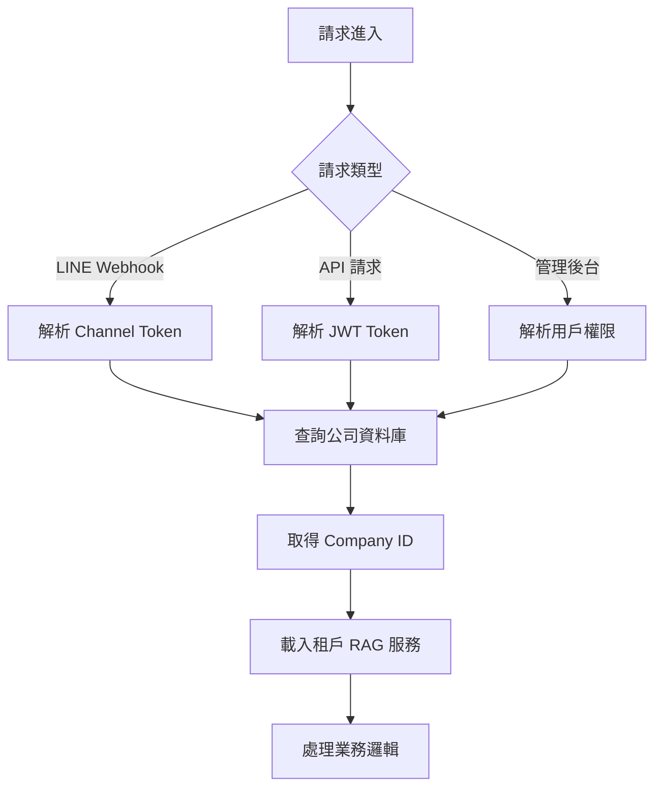
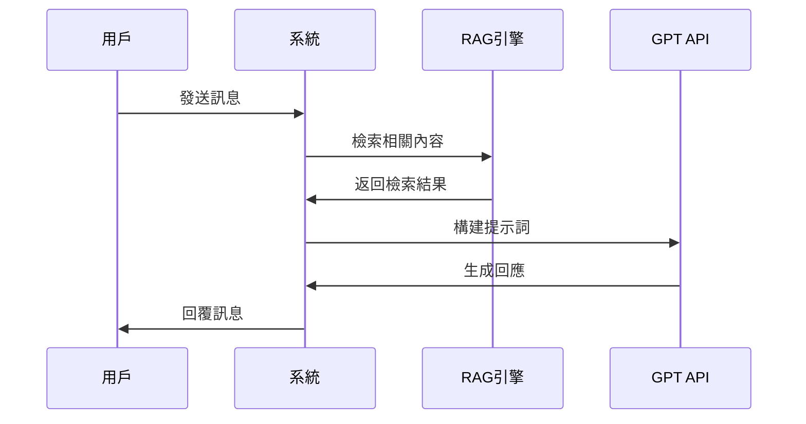

# LineRAG 多租戶 AI 智能客服系統 - 系統架構文檔

## 📋 文檔資訊

- **版本**: 2.0.0
- **更新日期**: 2025-01-27
- **作者**: LineRAG 開發團隊
- **適用對象**: 技術決策者、系統架構師、開發團隊

---

## 🎯 系統概述

LineRAG 是一套企業級多租戶 AI 智能客服系統，採用先進的多模態 RAG（Retrieval-Augmented Generation）技術，為多家企業提供統一管理的智能客服解決方案。

### 核心特色

- **多租戶架構**: 單一系統支援多家公司，資料完全隔離
- **多模態 RAG**: 支援文字、圖像、表格、公式等複雜內容處理
- **GPT API 深度整合**: 確保對話品質與自然度
- **多渠道支援**: LINE 官方帳號、官網聊天框無縫整合
- **知識圖譜增強**: 自動建立實體關係，提升檢索準確性

---

## 🏗️ 整體架構設計

### 系統架構圖

```
┌─────────────────────────────────────────────────────────────────┐
│                        前端層 (Frontend Layer)                    │
├─────────────────────────────────────────────────────────────────┤
│  統一管理後台     │    LINE Bot      │    官網聊天框              │
│  (Next.js)       │   (Webhook)      │   (Web Widget)            │
└─────────────────────────────────────────────────────────────────┘
                                │
                                ▼
┌─────────────────────────────────────────────────────────────────┐
│                        API 閘道層 (API Gateway)                   │
├─────────────────────────────────────────────────────────────────┤
│  • JWT 認證中介軟體                                               │
│  • 租戶識別與路由                                                 │
│  • CORS 跨域處理                                                 │
│  • 請求限流與監控                                                 │
└─────────────────────────────────────────────────────────────────┘
                                │
                                ▼
┌─────────────────────────────────────────────────────────────────┐
│                      應用服務層 (Application Layer)                │
├─────────────────────────────────────────────────────────────────┤
│  多租戶 RAG 服務    │  用戶管理服務    │  文檔管理服務              │
│  (MultiTenant RAG)  │  (User Service)  │  (Document Service)       │
│                     │                  │                           │
│  • 租戶隔離         │  • 權限控制      │  • 多模態處理             │
│  • 動態服務實例     │  • 審計日誌      │  • 向量化處理             │
│  • 知識圖譜管理     │  • LINE 用戶管理 │  • 檔案儲存管理           │
└─────────────────────────────────────────────────────────────────┘
                                │
                                ▼
┌─────────────────────────────────────────────────────────────────┐
│                      核心引擎層 (Core Engine Layer)                │
├─────────────────────────────────────────────────────────────────┤
│  RAG-Anything 引擎  │  GPT API 整合    │  知識圖譜引擎              │
│                     │                  │                           │
│  • 多模態文檔解析   │  • 對話管理      │  • 實體提取               │
│  • 語義檢索         │  • 錯誤處理      │  • 關係映射               │
│  • 混合檢索模式     │  • 費用控制      │  • 圖譜查詢               │
└─────────────────────────────────────────────────────────────────┘
                                │
                                ▼
┌─────────────────────────────────────────────────────────────────┐
│                        資料層 (Data Layer)                        │
├─────────────────────────────────────────────────────────────────┤
│  PostgreSQL         │  Qdrant          │  檔案儲存                 │
│  (關聯式資料庫)      │  (向量資料庫)     │  (File Storage)           │
│                     │                  │                           │
│  • 租戶資料         │  • 多模態向量     │  • 原始文檔               │
│  • 用戶資訊         │  • 語義索引       │  • 處理後檔案             │
│  • 審計日誌         │  • 檢索快取       │  • 臨時檔案               │
│  • 系統配置         │  • 知識圖譜向量   │  • 備份檔案               │
└─────────────────────────────────────────────────────────────────┘
```

---

## 🏢 多租戶架構設計

### 租戶隔離策略

#### 1. **資料隔離**
```python
# 公司資料完全分離
Company A: /rag_storage/company_1/
├── documents/          # 文檔檔案
├── vectors/           # 向量索引
├── knowledge_graph/   # 知識圖譜
└── cache/            # 快取檔案

Company B: /rag_storage/company_2/
├── documents/
├── vectors/
├── knowledge_graph/
└── cache/
```

#### 2. **服務實例隔離**
- 每個租戶擁有獨立的 RAG 服務實例
- 動態載入租戶專屬配置
- 記憶體中的服務實例快取機制

#### 3. **配置隔離**
```sql
-- 公司配置表
CREATE TABLE companies (
    id SERIAL PRIMARY KEY,
    name VARCHAR(255) NOT NULL,
    code VARCHAR(50) UNIQUE NOT NULL,
    line_channel_token TEXT,
    line_channel_secret VARCHAR(255),
    rag_working_dir VARCHAR(255),
    storage_quota_gb INTEGER DEFAULT 10,
    max_documents INTEGER DEFAULT 1000,
    max_queries_per_month INTEGER DEFAULT 10000
);
```

### 租戶識別流程



---

## 🧠 多模態 RAG 引擎架構

### RAG-Anything 整合

#### 1. **文檔處理管線**
```python
文檔上傳 → 格式檢測 → 多模態解析 → 內容提取 → 向量化 → 索引建立
    ↓
PDF/Office → 文字+圖像+表格 → 語義分析 → 向量嵌入 → Qdrant 儲存
```

#### 2. **檢索策略**
- **文字檢索**: TF-IDF + 語義向量檢索
- **圖像檢索**: 視覺特徵向量匹配
- **表格檢索**: 結構化資料查詢
- **混合檢索**: 多模態融合排序

#### 3. **知識圖譜增強**
```python
實體提取 → 關係識別 → 圖譜建構 → 語義推理 → 檢索增強
    ↓
NER → Relation Extraction → Graph Database → Inference → Enhanced Retrieval
```

---

## 🔗 GPT API 整合架構

### 對話管理系統

#### 1. **對話流程**


#### 2. **提示詞工程**
```python
# 動態提示詞模板
PROMPT_TEMPLATE = """
你是 {company_name} 的專業客服助理。

相關資料：
{retrieved_content}

用戶問題：{user_query}

請基於提供的資料回答用戶問題，如果資料不足請誠實說明。
回答要專業、友善且符合 {company_name} 的服務標準。
"""
```

#### 3. **錯誤處理與重試機制**
- API 限流處理
- 網路錯誤重試
- 回應品質檢查
- 費用監控與控制

---

## 🔐 安全架構設計

### 認證與授權

#### 1. **JWT 認證機制**
```python
# Token 結構
{
    "user_id": 123,
    "company_id": 1,
    "role": "admin",
    "permissions": ["read", "write", "manage"],
    "exp": 1640995200
}
```

#### 2. **權限控制矩陣**
| 角色       | 公司管理 | 文檔管理 | 用戶管理 | 系統設定 |
| ---------- | -------- | -------- | -------- | -------- |
| 系統管理員 | ✅        | ✅        | ✅        | ✅        |
| 公司管理員 | 限本公司 | ✅        | 限本公司 | 限本公司 |
| 一般用戶   | ❌        | 限讀取   | 限個人   | ❌        |

#### 3. **資料安全措施**
- 資料庫連接加密
- 敏感資料欄位加密
- API 請求簽名驗證
- 審計日誌完整記錄

---

## 📊 效能與擴展性設計

### 效能優化策略

#### 1. **快取機制**
```python
# 多層快取架構
L1: 記憶體快取 (服務實例快取)
L2: Redis 快取 (檢索結果快取)
L3: 檔案快取 (向量索引快取)
```

#### 2. **資料庫優化**
- 連接池管理
- 查詢索引優化
- 讀寫分離設計
- 分區表策略

#### 3. **向量檢索優化**
- HNSW 索引演算法
- 量化壓縮技術
- 批次檢索處理
- 結果快取機制

### 擴展性設計

#### 1. **水平擴展**
- 微服務架構設計
- 負載均衡配置
- 容器化部署
- 自動擴縮容

#### 2. **垂直擴展**
- 資源監控與調整
- 效能瓶頸識別
- 硬體升級建議
- 容量規劃指南

---

## 🔧 技術棧選擇

### 後端技術棧

| 技術             | 版本   | 用途         | 選擇理由                        |
| ---------------- | ------ | ------------ | ------------------------------- |
| **FastAPI**      | 0.104+ | Web 框架     | 高效能、自動 API 文檔、型別檢查 |
| **PostgreSQL**   | 14+    | 關聯式資料庫 | ACID 特性、JSON 支援、擴展性佳  |
| **Qdrant**       | 1.7+   | 向量資料庫   | 多模態支援、高效能檢索          |
| **SQLAlchemy**   | 2.0+   | ORM 框架     | 成熟穩定、多資料庫支援          |
| **Pydantic**     | 2.0+   | 資料驗證     | 型別安全、自動驗證              |
| **RAG-Anything** | Latest | RAG 引擎     | 多模態支援、易於整合            |

### 前端技術棧

| 技術             | 版本 | 用途       | 選擇理由                       |
| ---------------- | ---- | ---------- | ------------------------------ |
| **Next.js**      | 15+  | React 框架 | SSR 支援、效能優化、開發體驗佳 |
| **TypeScript**   | 5.0+ | 程式語言   | 型別安全、開發效率、維護性     |
| **Tailwind CSS** | 4.0+ | CSS 框架   | 快速開發、一致性設計           |
| **NextAuth.js**  | 5.0+ | 認證框架   | 多種認證方式、安全性高         |

---

## 📈 監控與日誌架構

### 系統監控

#### 1. **效能指標**
- API 回應時間
- 資料庫查詢效能
- 向量檢索延遲
- GPT API 使用量

#### 2. **業務指標**
- 租戶活躍度
- 查詢成功率
- 用戶滿意度
- 系統可用性

#### 3. **警報機制**
- 系統異常警報
- 效能閾值警報
- 資源使用警報
- 安全事件警報

### 日誌管理

#### 1. **日誌分類**
```python
# 日誌等級與用途
DEBUG: 開發除錯資訊
INFO:  一般操作記錄
WARN:  潛在問題警告
ERROR: 錯誤事件記錄
FATAL: 嚴重系統錯誤
```

#### 2. **審計日誌**
- 用戶操作記錄
- 資料變更追蹤
- 權限變更記錄
- 系統配置變更

---

## 🚀 部署架構建議

### 生產環境架構

```
┌─────────────────────────────────────────────────────────────────┐
│                          負載均衡器                              │
│                        (Nginx/HAProxy)                          │
└─────────────────────────────────────────────────────────────────┘
                                │
                ┌───────────────┼───────────────┐
                ▼               ▼               ▼
┌─────────────────┐ ┌─────────────────┐ ┌─────────────────┐
│   API Server 1  │ │   API Server 2  │ │   API Server N  │
│   (Container)   │ │   (Container)   │ │   (Container)   │
└─────────────────┘ └─────────────────┘ └─────────────────┘
                                │
                ┌───────────────┼───────────────┐
                ▼               ▼               ▼
┌─────────────────┐ ┌─────────────────┐ ┌─────────────────┐
│   PostgreSQL    │ │     Qdrant      │ │  File Storage   │
│   (Primary)     │ │   (Cluster)     │ │   (NFS/S3)      │
└─────────────────┘ └─────────────────┘ └─────────────────┘
```

### 容器化部署

#### 1. **Docker 配置**
```dockerfile
# 多階段建構優化
FROM python:3.11-slim as builder
# 建構階段...

FROM python:3.11-slim as runtime
# 運行階段...
```

#### 2. **Docker Compose 編排**
```yaml
version: '3.8'
services:
  api:
    build: .
    ports:
      - "8000:8000"
    environment:
      - DATABASE_URL=postgresql://...
      - QDRANT_URL=http://qdrant:6333
    depends_on:
      - postgres
      - qdrant
```

---

## 📋 系統需求規格

### 硬體需求

#### 最小需求 (開發/測試環境)
- **CPU**: 4 核心
- **記憶體**: 8GB RAM
- **儲存**: 100GB SSD
- **網路**: 100Mbps

#### 建議需求 (生產環境)
- **CPU**: 8+ 核心
- **記憶體**: 32GB+ RAM
- **儲存**: 500GB+ NVMe SSD
- **網路**: 1Gbps+

### 軟體需求

#### 作業系統
- Ubuntu 20.04+ LTS
- CentOS 8+
- Docker 支援的任何 Linux 發行版

#### 相依服務
- PostgreSQL 14+
- Qdrant 1.7+
- Redis 6+ (可選，用於快取)
- Nginx 1.20+ (反向代理)

---

## 🔄 系統整合介面

### 外部 API 整合

#### 1. **LINE Messaging API**
```python
# Webhook 端點
POST /webhook
Content-Type: application/json
X-Line-Signature: {signature}

# 回覆訊息 API
POST https://api.line.me/v2/bot/message/reply
Authorization: Bearer {channel_access_token}
```

#### 2. **OpenAI GPT API**
```python
# 聊天完成 API
POST https://api.openai.com/v1/chat/completions
Authorization: Bearer {api_key}
Content-Type: application/json
```

### 內部 API 介面

#### 1. **租戶管理 API**
```python
# 建立公司
POST /api/companies
# 更新公司設定
PUT /api/companies/{company_id}
# 取得公司資訊
GET /api/companies/{company_id}
```

#### 2. **文檔管理 API**
```python
# 上傳文檔
POST /api/documents/upload
# 查詢文檔
GET /api/documents
# 刪除文檔
DELETE /api/documents/{document_id}
```

---

## 📚 相關文檔索引

- [API 文檔](./API文檔.md) - 詳細的 API 規格說明
- [部署指南](./部署指南.md) - 完整的部署步驟
- [開發者指南](./開發者指南.md) - 開發環境設定與擴展指南
- [運維手冊](./運維手冊.md) - 系統監控與維護指南
- [故障排除](./故障排除.md) - 常見問題與解決方案

---

## 📞 技術支援

如有技術問題，請聯繫：
- **技術支援信箱**: support@linerag.com
- **文檔更新**: docs@linerag.com
- **緊急聯絡**: emergency@linerag.com

---

*本文檔版權所有 © 2025 LineRAG 開發團隊*