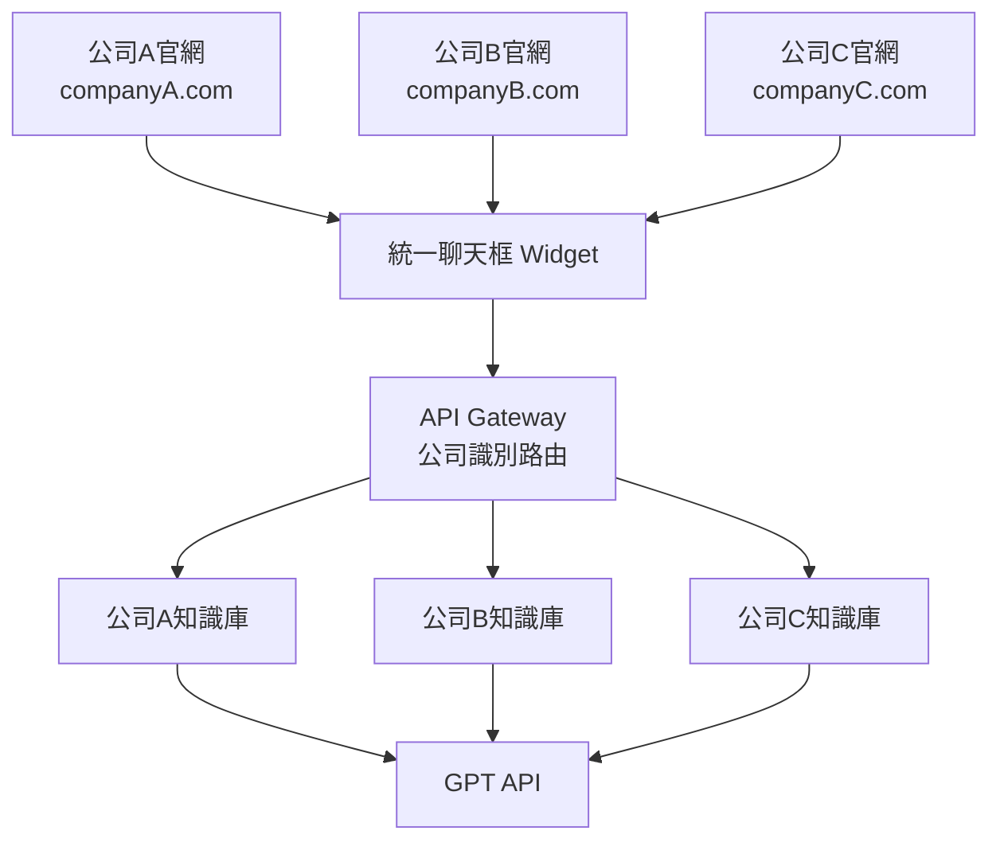

# **官網聊天框多公司切換技術規格文檔**

## **📋 文檔概述**

本文檔說明AI智能客服系統中，官網聊天框如何實現多公司切換的技術架構與實現方案。

**版本：** v1.0  
**更新日期：** 2025-08-13
**適用系統：** AI智能客服系統 - 方案A（多公司標準版）

---

## **🎯 需求背景**

### **業務需求**

- 一套AI客服系統需要支援多家公司（A、B、C公司等）
- 每家公司有自己的官網，需要嵌入聊天框
- 聊天框需要自動識別是哪家公司，使用對應的知識庫
- 統一管理後台，但各公司資料需要隔離

### **技術挑戰**

- 如何自動識別訪客來自哪家公司
- 如何確保各公司知識庫不會混淆
- 如何簡化各公司的嵌入與維護工作
- 如何保持系統架構的簡潔性

---

## **🏗️ 技術架構設計**

### **整體架構圖**



### **資料流程**

1. **用戶訪問** → 公司官網載入聊天框
2. **自動識別** → 根據域名識別公司身份
3. **路由分發** → API 路由到對應知識庫
4. **RAG 檢索** → 搜尋該公司相關文檔
5. **GPT 回應** → 生成個性化回答
6. **返回結果** → 顯示在聊天框中

---

## **💻 實現方案**

### **方案 1：域名自動識別（推薦）**

#### **前端實現**

```javascript
// chat-widget.js - 統一聊天框代碼
class ChatWidget {
  constructor() {
    this.companyId = this.detectCompany();
    this.apiEndpoint = 'https://api.your-system.com/chat';
    this.init();
  }

  detectCompany() {
    // 域名映射表
    const companyMapping = {
      'companyA.com': 'company_a',
      'companyA.com.tw': 'company_a',
      'companyB.com': 'company_b', 
      'companyB.com.tw': 'company_b',
      'companyC.com': 'company_c',
      'localhost': 'demo' // 開發環境
    };
    
    const hostname = window.location.hostname;
    return companyMapping[hostname] || 'default';
  }

  async sendMessage(message) {
    const response = await fetch(`${this.apiEndpoint}/${this.companyId}`, {
      method: 'POST',
      headers: {
        'Content-Type': 'application/json',
      },
      body: JSON.stringify({
        message: message,
        sessionId: this.getSessionId()
      })
    });
    
    return response.json();
  }
}

// 初始化聊天框
document.addEventListener('DOMContentLoaded', () => {
  new ChatWidget();
});
```

#### **後端實現**

```python
# FastAPI 後端路由
from fastapi import FastAPI, HTTPException
from typing import Dict
import os

app = FastAPI()

# 公司配置
COMPANY_CONFIGS = {
    'company_a': {
        'name': '公司A',
        'knowledge_base': 'documents/company_a/',
        'brand_color': '#FF6B6B'
    },
    'company_b': {
        'name': '公司B', 
        'knowledge_base': 'documents/company_b/',
        'brand_color': '#4ECDC4'
    },
    'company_c': {
        'name': '公司C',
        'knowledge_base': 'documents/company_c/', 
        'brand_color': '#45B7D1'
    }
}

@app.post("/chat/{company_id}")
async def handle_chat(company_id: str, chat_request: ChatRequest):
    # 驗證公司ID
    if company_id not in COMPANY_CONFIGS:
        raise HTTPException(status_code=404, detail="Company not found")
    
    config = COMPANY_CONFIGS[company_id]
    
    # 使用對應的知識庫進行RAG檢索
    rag_result = await search_knowledge_base(
        query=chat_request.message,
        knowledge_base=config['knowledge_base']
    )
    
    # 呼叫GPT API生成回應
    response = await generate_response(
        message=chat_request.message,
        context=rag_result,
        company_name=config['name']
    )
    
    # 記錄對話
    await log_conversation(company_id, chat_request, response)
    
    return {
        "response": response,
        "company": config['name'],
        "brand_color": config['brand_color']
    }
```

---

### **方案 2：嵌入參數配置**

#### **各公司嵌入代碼**

```html
<!-- 公司A網站嵌入 -->
<script>
  window.chatConfig = {
    companyId: 'company_a',
    companyName: '公司A',
    brandColor: '#FF6B6B',
    apiEndpoint: 'https://api.your-system.com/chat'
  };
</script>
<script src="https://api.your-system.com/chat-widget.js"></script>

<!-- 公司B網站嵌入 -->
<script>
  window.chatConfig = {
    companyId: 'company_b',
    companyName: '公司B', 
    brandColor: '#4ECDC4',
    apiEndpoint: 'https://api.your-system.com/chat'
  };
</script>
<script src="https://api.your-system.com/chat-widget.js"></script>
```

---

### **方案 3：API Key 識別**

```javascript
// 每家公司分配獨立的API Key
const chatWidget = new ChatWidget({
  apiKey: 'sk-company-a-12345678', // 公司A專用Key
  endpoint: 'https://api.your-system.com/chat'
});

// 後端根據API Key識別公司
@app.post("/chat")
async def handle_chat(request: ChatRequest, api_key: str = Header(...)):
    company_id = get_company_by_api_key(api_key)
    # 後續處理...
```

---

## **📁 文件結構設計**

### **前端文件結構**

```bash
web/
├── public/
│   ├── chat-widget.js           # 統一聊天框主文件
│   ├── chat-widget.css          # 聊天框樣式
│   └── company-configs/         # 各公司配置文件
│       ├── company-a.json
│       ├── company-b.json
│       └── company-c.json
├── src/
│   ├── components/
│   │   └── ChatWidget/
│   │       ├── ChatWidget.jsx
│   │       ├── MessageBubble.jsx
│   │       └── InputArea.jsx
│   └── utils/
│       ├── companyDetector.js   # 公司識別邏輯
│       └── apiClient.js         # API 呼叫封裝
```

### **後端文件結構**

```bash
api/
├── routers/
│   ├── chat.py                  # 聊天API路由
│   └── companies.py             # 公司管理API
├── services/
│   ├── rag_service.py           # RAG檢索服務
│   ├── gpt_service.py           # GPT API服務
│   └── company_service.py       # 公司配置服務
├── models/
│   ├── chat.py                  # 聊天資料模型
│   └── company.py               # 公司資料模型
└── config/
    ├── companies.yaml           # 公司配置文件
    └── domains.yaml             # 域名映射配置
```

---

## **🔧 配置管理**

### **公司配置文件範例**

```yaml
# config/companies.yaml
companies:
  company_a:
    name: "公司A"
    display_name: "某某科技股份有限公司"
    domains:
      - "companyA.com"
      - "companyA.com.tw"
      - "www.companyA.com"
    knowledge_base: "documents/company_a/"
    brand_config:
      primary_color: "#FF6B6B"
      secondary_color: "#FF8E8E"
      logo_url: "/logos/company-a.png"
    chat_config:
      welcome_message: "您好！歡迎來到公司A，有什麼可以為您服務的嗎？"
      max_message_length: 500
      enable_file_upload: true
    
  company_b:
    name: "company_b"
    display_name: "某某貿易有限公司"
    domains:
      - "companyB.com"
      - "companyB.com.tw"
    knowledge_base: "documents/company_b/"
    brand_config:
      primary_color: "#4ECDC4"
      secondary_color: "#7ED4CC"
      logo_url: "/logos/company-b.png"
    chat_config:
      welcome_message: "歡迎來到公司B！我是您的專屬AI助理"
      max_message_length: 300
      enable_file_upload: false
```

### **域名映射配置**

```yaml
# config/domains.yaml
domain_mapping:
  "companyA.com": "company_a"
  "companyA.com.tw": "company_a"
  "www.companyA.com": "company_a"
  "companyB.com": "company_b"
  "companyB.com.tw": "company_b"
  "companyC.com": "company_c"
  "localhost:3000": "demo"  # 開發環境
  "staging.your-system.com": "demo"  # 測試環境
```

---

## **🚀 部署與維護**

### **部署流程**

1. **聊天框部署**

   ```bash
   # 編譯聊天框文件
   npm run build:widget
   
   # 部署到CDN
   aws s3 cp dist/chat-widget.js s3://your-cdn/chat-widget.js
   aws s3 cp dist/chat-widget.css s3://your-cdn/chat-widget.css
   ```

2. **各公司嵌入**

   ```html
   <!-- 各公司只需要在網站加入這一行 -->
   <script src="https://your-cdn.com/chat-widget.js"></script>
   ```

3. **新增公司步驟**
   - 在 `companies.yaml` 添加公司配置
   - 在 `domains.yaml` 添加域名映射
   - 創建公司知識庫資料夾
   - 重啟API服務（或使用熱更新）

### **維護任務**

#### **日常維護**

- 監控各公司聊天框使用狀況
- 更新公司知識庫內容
- 檢查API使用量和費用

#### **擴展維護**

- 新增公司：修改配置文件即可
- 域名變更：更新域名映射
- 功能升級：統一更新聊天框代碼

---

## **🔐 安全性考量**

### **資料隔離**

- 各公司知識庫完全分離存儲
- API路由層面確保公司資料不混淆
- 對話記錄按公司分別儲存

### **防濫用機制**

- API Rate Limiting 按公司分別計算
- 訊息長度限制
- 敏感內容過濾

### **域名驗證**

```javascript
// 前端域名白名單驗證
const ALLOWED_DOMAINS = [
  'companyA.com', 'companyB.com', 'companyC.com'
];

if (!ALLOWED_DOMAINS.some(domain => window.location.hostname.includes(domain))) {
  console.error('Unauthorized domain');
  return;
}
```

---

## **📊 監控與分析**

### **使用統計**

- 各公司聊天框使用頻率
- 問答成功率分析
- 用戶滿意度回饋

### **效能監控**

- API回應時間
- GPT API使用量
- 系統負載狀況

### **錯誤追蹤**

- 公司識別失敗記錄
- API呼叫錯誤日誌
- 前端JavaScript錯誤

---

## **🚧 已知限制與改進計畫**

### **當前限制**

- 同一公司多個子域名需要手動配置
- 聊天框樣式客製化程度有限
- 無法即時切換公司配置（需重啟）

### **未來改進**

- 支援正則表達式域名匹配
- 提供聊天框主題編輯器
- 實現配置熱更新機制
- 增加A/B測試功能

---

## **📞 技術支援**

**文檔維護：** 開發團隊  
**技術諮詢：** 透過技術支援管道  
**更新頻率：** 功能更新時同步更新文檔

---
